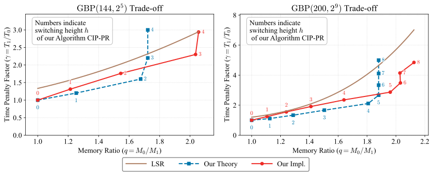
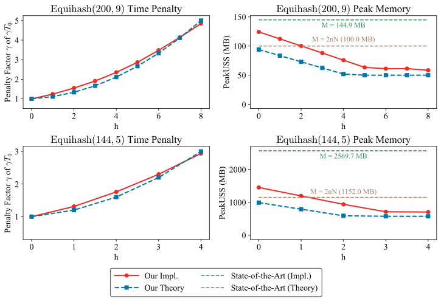

# Wagner-Algorithms

Code accompanying the paper: "Memory Optimizations of Wagner’s Algorithm with Applications to Equihash". The paper is available at https://eprint.iacr.org/2025/2141. The artifact is organized as follows:

- **`python-poc/`**: Python scripts for memory estimation and algorithmic proofs-of-concept. This corresponds to the theoretical results and tables in the paper.
- **`advanced-cip/`**: Optimized C++ implementations of the Equihash algorithm using the proposed Advanced Post-Retrieval (APR) techniques. This is used for the performance benchmarks reported in the paper.
- **`pics/`**: Helper scripts to generate the plots used in the paper.
- **`third_party/`**: External dependencies and baseline implementations (Tromp's Equihash, BLAKE2b, kxsort).

## New Memory Optimizations of Wagner's Algorithms

We propose two new techniques to optimize Wagner's algorithms:

- **Improved Index-Trimming Technique**: Reduces memory usage by trimming indexes for both the single-chain and $k$-tree algorithms implemented with index vectors.
- **Post-Retrival Technique**: Reduces memory usage by reconstructing the index pointers for single-chain algorithm implemented with index pointers. It's not memory-efficient for the $k$-tree algorithm.
- **In-place Merge**: All of these optimizations rely on our newly proposed in-place $`\textsf{merge}`$ framework. See [merge_in_place.py](advanced-cip/merge_in_place.py) and [inplace_merge_benchmark.cpp](advanced-cip/src/inplace_merge/inplace_merge_benchmark.cpp) for the core idea and algorithmic details.

Theoretically, our techniques can reduce the peak memory usage of Wagner's algorithm by half (from $`2nN`$ to $`nN`$ bits) across most parameter settings, while incurring no more than a twofold time penalty. For example, the figure below shows that our new advanced post-retrieval technique achieves an almost linear time–memory trade-off curve, which is strictly better than the curve obtained by existing List Size Reduction (LSR) techniques.



- The above LSR curve is not applicable to algorithm-bound Equihash, whereas our algorithm is. 
- For algorithm-bound LSR trade-offs applicable to \textsf{Equihash}, the resulting curves are not of the same order of magnitude as those shown above and are therefore omitted. For example, for Equihash(144,5), halving the memory leads to a time-penalty factor as large as $2^{10}$.
- For the LSR curve above, the reason why the time penalty is slightly above 1 when q=1 is that their baseline algorithm differs from the standard Wagner algorithm.

Under the hybrid framework, the memory footprint can be further reduced (below $`nN`$ bits, i.e., q < 0.5) at the cost of additional computational overhead. **More estimators and theoretic resluts are available in [python-poc](./python-poc/).**

## Implementations of Post-Retrieval Technique

Our implementation serves solely as a proof of concept and does not incorporate aggressive low-level optimizations. We also note that these optimizations may significantly impact the ASIC-resistance of existing blockchains that rely on $`\textsf{Equihash}`$. We therefore recommend that such blockchains reassess the memory bottlenecks of ASIC implementations across all $`\textsf{Equihash}`$ parameter settings. 



For the parameter setting $`\textsf{Equihash}(144, 5)`$, a subset of our optimization results is shown below (serving only as a proof of concept). Our implementations outperform Tromp's baseline implementation (CIP) in both time and memory usage.

| Algorithm      | Sol/s | Avg RunTime (s) | Total solutions | Peak USS (MB) |
| -------------- | ----: | --------------: | --------------: | ------------: |
| CIP            |  0.23 |            8.45 |             198 |       1453.12 |
| CIP-PR         |  0.08 |           24.94 |             198 |        706.79 |
| CIP-EM         |  0.22 |            9.05 |             198 |        707.54 |
| CIP-APR        |  0.10 |           19.77 |             198 |        713.68 |
| Tromp-Baseline |  0.20 |            9.11 |             190 |       2569.69 |

> Notes: "Avg single run (s)" is the average per-iteration runtime reported by the benchmark (for Tromp the total time was divided by 100 iterations to obtain the per-run average).
> Details are available in the directories [advanced-cip](./advanced-cip/).


## Quick Start

**Clone the repository**:
```bash
git clone --depth 1 https://github.com/tl2cents/Wagner-Algorithms.git
cd Wagner-Algorithms
```

1.  **Explore Estimators (Python)**:
    Navigate to [python-poc](./python-poc) to run estimation scripts and proof-of-concept of our improved index-trimming technique.

2.  **Run Benchmarks (C++)**:
    Navigate to [advanced-cip](./advanced-cip) to build and run the C++ benchmarks (advanced post-retrieval technique).

## TODO
- [ ] Implement hybrid single-chain algorithms. See our on-going development branch [dev-hybrid](https://github.com/tl2cents/Wagner-Algorithms/tree/dev-hybrid).